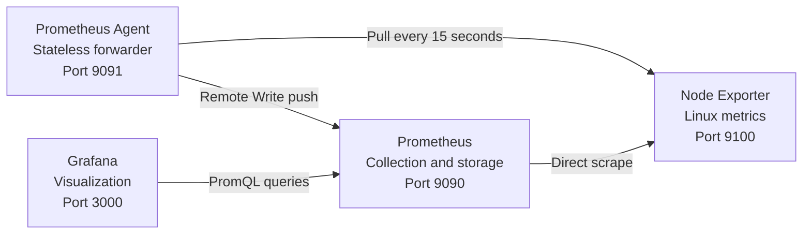
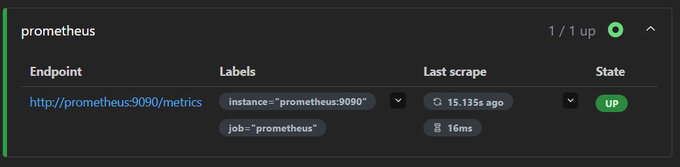
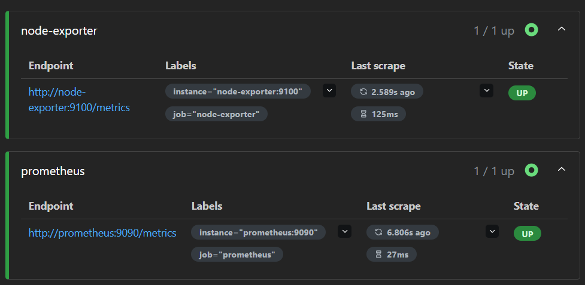
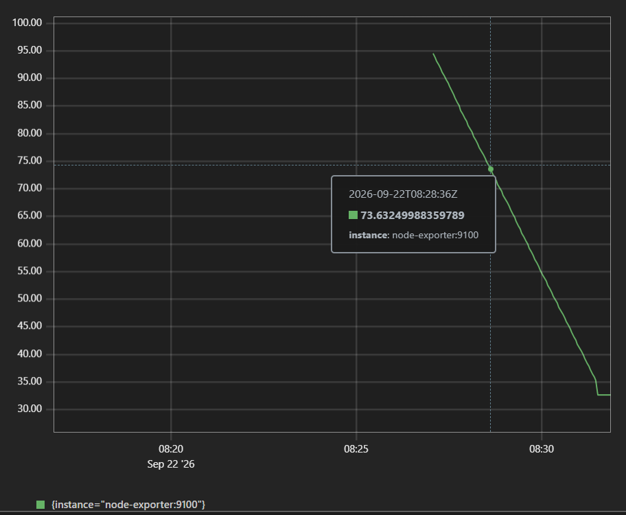
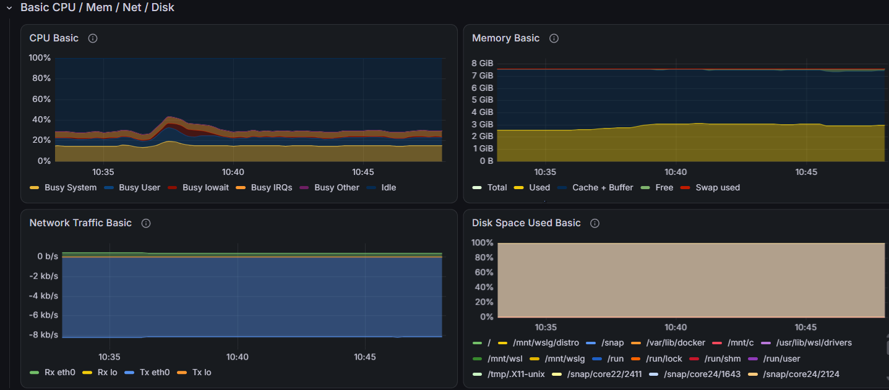
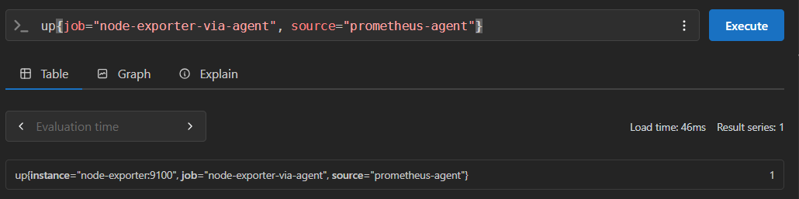
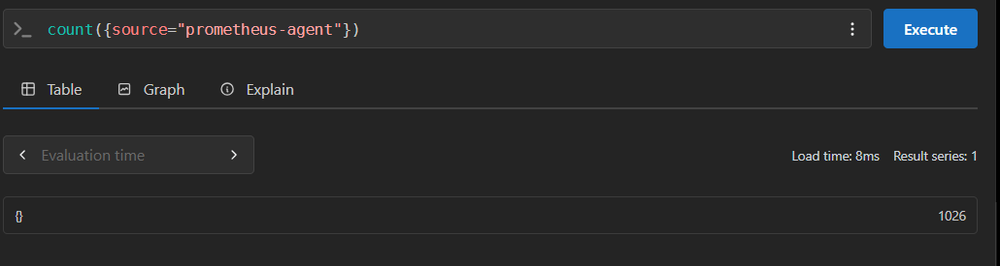

# Monitoring with Prometheus Node Exporter and Grafana

This project deploys a local monitoring stack with Docker Compose. Node Exporter exposes Linux host metrics, Prometheus collects them using its pull model, and Grafana displays them in dashboards. The bonus implementation adds a stateless Prometheus Agent that scrapes Node Exporter and forwards the samples to the main Prometheus server through Remote Write.

## Architecture



| Service | Purpose | Local address |
|---|---|---|
| Prometheus | Collects, stores, and queries metrics | `http://localhost:9090` |
| Node Exporter | Exposes CPU, memory, disk, and network metrics | `http://localhost:9100/metrics` |
| Prometheus Agent | Scrapes and forwards metrics without a full local TSDB | `http://localhost:9091` |
| Grafana | Displays metrics in dashboards | `http://localhost:3000` |

## Prerequisites

- Docker and Docker Compose
- A Linux host, a Linux virtual machine, or WSL with Docker Desktop
- Ports `3000`, `9090`, `9091`, and `9100` available

> Node Exporter is designed for Linux and Unix systems. With WSL and Docker Desktop, the collected metrics mainly describe the Linux environment used by Docker rather than the native Windows host.

## Project structure

```text
tp-monitoring-prometheus-grafana/
├── docker-compose.yml
├── prometheus/
│   ├── prometheus.yml
│   └── prometheus-agent.yml
├── screenshots/
└── README.md
```

Prometheus and Grafana data are persisted in the `prometheus-data` and `grafana-data` Docker volumes.

## Start the stack

First, validate the Compose file:

```bash
docker compose config
```

Start all four services:

```bash
docker compose up -d
```

Check their status:

```bash
docker compose ps
```

The `prometheus`, `prometheus-agent`, `node-exporter`, and `grafana` containers should be `Up` or `running`.

## Prometheus configuration

The `prometheus/prometheus.yml` file defines two scrape jobs:

- `prometheus`: Prometheus collects its own metrics from `prometheus:9090`;
- `node-exporter`: Prometheus collects Linux host metrics from `node-exporter:9100`.

Validate the configuration with:

```bash
docker compose exec prometheus \
  promtool check config /etc/prometheus/prometheus.yml
```

The expected result is `SUCCESS`.

After changing the configuration, restart Prometheus:

```bash
docker compose restart prometheus
```

## Verify the scrape targets

Open [http://localhost:9090/targets](http://localhost:9090/targets). Both the `prometheus` and `node-exporter` targets should have the `UP` state.

### Prometheus collecting its own metrics



### Prometheus and Node Exporter targets



## Tested PromQL queries

Run these queries from [http://localhost:9090/query](http://localhost:9090/query).

### Service availability

```promql
up
```

A value of `1` means the target is reachable. A value of `0` means Prometheus cannot scrape it.

To check only Node Exporter:

```promql
up{job="node-exporter"}
```

### Host information

```promql
node_uname_info
```

### Memory usage percentage

```promql
100 * (
  1 - node_memory_MemAvailable_bytes
  / node_memory_MemTotal_bytes
)
```

### CPU usage percentage

```promql
100 - (
  avg by (instance) (
    rate(node_cpu_seconds_total{mode="idle"}[5m])
  ) * 100
)
```



## Configure Grafana

1. Open [http://localhost:3000](http://localhost:3000).
2. Sign in to Grafana.
3. Open **Connections**, then **Data sources**.
4. Add a **Prometheus** data source.
5. Enter the following internal URL:

```text
http://prometheus:9090
```

6. Click **Save and test**.

Do not use `localhost:9090` in Grafana. Inside the Grafana container, `localhost` refers to Grafana itself. Docker Compose resolves the `prometheus` service name through its internal network.

## Grafana dashboard

The community **Node Exporter Full** dashboard, ID `1860`, was imported from **Dashboards > New > Import**.

Select the Prometheus data source and the `node-exporter:9100` instance. A time range such as **Last 15 minutes** makes it easy to confirm that metrics are arriving.



## Bonus Prometheus Agent and Remote Write

The bonus adds a second Prometheus instance running in Agent mode. It pulls metrics from Node Exporter and pushes them to the main Prometheus server.

The main Prometheus enables its receiver with:

```yaml
command:
  - "--config.file=/etc/prometheus/prometheus.yml"
  - "--web.enable-remote-write-receiver"
```

The Agent uses `prometheus/prometheus-agent.yml`:

```yaml
global:
  scrape_interval: 15s
  external_labels:
    source: "prometheus-agent"

scrape_configs:
  - job_name: "node-exporter-via-agent"
    static_configs:
      - targets:
          - "node-exporter:9100"

remote_write:
  - url: "http://prometheus:9090/api/v1/write"
```

The `source="prometheus-agent"` external label distinguishes samples forwarded by the Agent from metrics scraped directly by the main server.

Validate the Agent configuration with:

```bash
docker compose run --rm --entrypoint promtool prometheus-agent \
  check config /etc/prometheus/prometheus-agent.yml
```

The Agent target is available from [http://localhost:9091/targets](http://localhost:9091/targets).


The following query, executed on the main Prometheus server, proves that forwarded samples have arrived:

```promql
up{job="node-exporter-via-agent", source="prometheus-agent"}
```



The total number of series received from the Agent can be checked with:

```promql
count({source="prometheus-agent"})
```



The screenshots confirm the complete bonus data path:

```text
Node Exporter -> Prometheus Agent -> Remote Write -> Main Prometheus -> Grafana
```

## Final verification

```bash
docker compose ps
curl --fail http://localhost:9090/-/ready
curl --fail http://localhost:9091/-/ready
curl --fail http://localhost:9100/metrics
curl --fail http://localhost:3000/api/health
```

The lab is complete when:

- all four containers are running;
- both Prometheus targets are `UP`;
- the Agent target `node-exporter-via-agent` is `UP`;
- the main Prometheus returns Agent metrics with `source="prometheus-agent"`;
- the PromQL queries return data;
- Grafana can query Prometheus;
- the dashboard displays CPU, memory, disk, and network metrics;
- the Grafana configuration and dashboard remain available after `docker compose restart`.

## Troubleshooting

### Docker Desktop reports an `rslave` mount error

Docker Desktop does not support this bind propagation mode. Use the following Node Exporter volume declaration:

```yaml
volumes:
  - "/:/host:ro"
```

### A target is `DOWN`

```bash
docker compose ps
docker compose logs --tail=50 prometheus
docker compose logs --tail=50 node-exporter
```

Also confirm that the Prometheus target is set to `node-exporter:9100`.

### The Prometheus Agent keeps restarting

If the logs contain `opening storage failed` or `permission denied`, use the writable `/prometheus` directory for the temporary Agent WAL:

```yaml
command:
  - "--agent"
  - "--config.file=/etc/prometheus/prometheus-agent.yml"
  - "--storage.agent.path=/prometheus"
```

Do not attach a persistent volume to this path when the Agent must remain stateless. Recreate it after changing the command:

```bash
docker compose up -d --force-recreate prometheus-agent
```

### Grafana displays `No data`

- confirm that `node-exporter` is `UP` in Prometheus;
- select the correct Prometheus data source;
- select the `node-exporter:9100` instance;
- increase the displayed time range to **Last 15 minutes**.

## Stop the stack

Stop and remove the containers while keeping the stored data:

```bash
docker compose down
```

> Do not add the `-v` option if the Prometheus data and Grafana dashboards must be preserved.

## Resources

- [Prometheus first steps](https://prometheus.io/docs/introduction/first_steps/)
- [Official Node Exporter guide](https://prometheus.io/docs/guides/node-exporter/)
- [PromQL documentation](https://prometheus.io/docs/prometheus/latest/querying/basics/)
- [Grafana Prometheus data source](https://grafana.com/docs/grafana/latest/datasources/prometheus/)
- [Import Grafana dashboards](https://grafana.com/docs/grafana/latest/visualizations/dashboards/build-dashboards/import-dashboards/)
